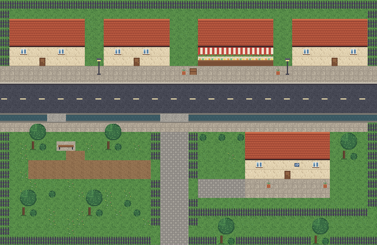

# THE LAST REMNANT

> *Sebelum semuanya terlupakan.*

Game naratif-puzzle 2D pixel art berbasis **Java 17+ / LibGDX 1.13.1**.  
Final Project Pemrograman Berorientasi Objek, **Kelompok 7**.

Iwan, kurir di Depok Selatan, mengantar paket tanpa pengirim bertuliskan "Untuk yang masih ingat." Isinya **The Remnant**, perangkat yang bisa membaca memori dari benda-benda. Dari situ Iwan sadar bahwa sistem bernama **Brown Teddy** memang menghapus kenangan yang menyakitkan, tetapi ikut menghapus bagian penting dari identitas manusia.



---

## Status: Prototype W2 (milestone 17 November)

| Minggu | Target Gantt | Status |
|---|---|---|
| W1 · 4–10 Nov | Setup repo, interface, naskah, player & collision | ✅ |
| **W2 · 11–17 Nov** | **Sistem dialog, MemoryDevice + jurnal, MainMenu + GameScreen, integrasi + unit test** | ✅ **prototype playable** |
| W3 · 18–24 Nov | World/peta kota, Puzzle + QuestManager, konten NPC, DialogueUI/JournalUI final | ⏳ |
| W4 · 25 Nov–1 Des | 3 fragmen memori, 2 ending, Pause & Ending screen | ⏳ |
| W5 · 2–8 Des | Regression test, debugging, final release | ⏳ |

**Isi prototype W2:** menu utama → intro → jalan-jalan dengan collision → bicara dengan Bu Sari (dialog bercabang) → antar paket ke Pak Darto → **The Remnant** aktif → pindai 3 benda (radio, foto, layangan) → kilas balik + entri jurnal → percakapan penutup dengan Bu Sari (akhir W2).

---

## Menjalankan

Butuh **JDK 17 atau lebih baru** (tim memakai OpenJDK 21). Gradle tidak perlu di-install karena wrapper sudah disertakan.

```bash
# Windows
gradlew.bat lwjgl3:run

# macOS / Linux
./gradlew lwjgl3:run

# unit test semua modul
./gradlew core:test

# buat .jar yang bisa dijalankan langsung
./gradlew lwjgl3:jar          # -> lwjgl3/build/libs/TheLastRemnant-0.2.0.jar
```

Di IntelliJ IDEA: **File → Open →** pilih folder proyek ini (Gradle akan ter-import otomatis).  
Menjalankan dari IDE: panel Gradle → `lwjgl3 → Tasks → application → run`.

### Kontrol

| Tombol | Aksi |
|---|---|
| W A S D / Panah | Berjalan |
| E / Spasi / Enter | Bicara, periksa, lanjut dialog |
| W/S lalu E, atau 1–4, atau klik | Pilih jawaban dialog |
| J / Tab | Buka/tutup jurnal |
| Esc | Kembali ke menu *(diganti Pause Menu di W4)* |
| F11 | Layar penuh |

---

## Pembagian Tim & Lokasi Kode

Setiap file Java punya komentar header berisi **bagian**, **penanggung jawab (PJ)**, dan **minggu** pengerjaannya.

| Anggota | Tanggung jawab | File utama (core/src/main/java/com/kelompok7/lastremnant/) |
|---|---|---|
| **Iqbal** | Core gameplay & world | `entity/Entity`, `entity/Player`, `entity/Direction`, `entity/CharacterSprites`, `world/World`, `world/CollisionSystem`, `input/*` |
| **Carlos** | Dialogue & story, aset | `dialogue/*`, `story/*`, `entity/NPC`, `assets/GameAssets`, `assets/data/dialogues.json`, `characters.json`, `tools/generate_placeholder_assets.py` |
| **Insan** | Puzzle, memory, quest | `memory/*`, `entity/MemoryObject`, `assets/data/memories.json` |
| **Setiawan** | UI & game flow | `LastRemnantGame`, `screens/MainMenu`, `screens/GameScreen`, `state/*`, `ui/*` |
| Tim | Integrasi & setup | `util/Constants`, `entity/Interactable`, `entity/InteractionContext`, `lwjgl3/*`, file Gradle, `data/StoryDataIntegrityTest` |

---

## Desain OOP (sesuai proposal)

| Konsep | Di mana | Penjelasan singkat |
|---|---|---|
| **Abstraction** | `Entity` (abstract), `GameState`, `Interactable`, `Command` | Kontrak tanpa detail implementasi |
| **Inheritance** | `Player`, `NPC`, `MemoryObject` → `Entity` | Mewarisi posisi, hitbox, dan urutan gambar |
| **Encapsulation** | `StoryManager`, `Journal`, `MemoryDevice` | Status hanya berubah lewat method publik |
| **Polymorphism** | `GameScreen.updateWorld()` / `render()` memanggil semua `Entity`; `ExplorationState` memanggil `Interactable.interact()` | Tanpa cek tipe atau `instanceof` |

### Design Patterns

| Pattern | Kelas | Alur |
|---|---|---|
| **Command** | `InputHandler`, `Command`, `MoveCommand`, `InteractCommand` | Tombol → Command → Player (kontrol bisa di-rebind) |
| **State** | `GameStateManager`, `ExplorationState`, `DialogueState`, `JournalState` | Tumpukan state, tanpa rantai if-else di GameScreen |
| **Observer** | `StoryManager` → `Hud`; `Journal` → `Hud` | Tujuan/jurnal berubah → HUD memperbarui dirinya *(W3: QuestManager → JournalUI, StoryManager)* |

```
LastRemnantGame (Game)
 ├─ MainMenu (Screen)
 └─ GameScreen (Screen, InteractionContext, DialogueActionHandler)
     ├─ GameStateManager ── Exploration | Dialogue | Journal   (W3: Puzzle, W4: Pause, Ending)
     ├─ World ── CollisionSystem
     ├─ Entity[] ── Player | NPC | MemoryObject
     ├─ InputHandler ── Command
     ├─ StoryManager ──(observer)──► Hud
     ├─ MemoryDevice ── Journal ──(observer)──► Hud
     └─ UI: Hud, DialogueUI, JournalUI  (Scene2D)
```

---

## Struktur Folder

```
assets/
  data/        dialogues.json, characters.json, memories.json   ← naskah & data (edit tanpa coding)
  maps/        test_area.tmx + town_tiles.png                    ← buka dengan Tiled
  sprites/ ui/ fonts/ sfx/                                       ← aset SEMENTARA (lihat di bawah)
core/          semua logika game + unit test
lwjgl3/        launcher desktop
tools/         generate_placeholder_assets.py
docs/          panduan W2, laporan mingguan, preview peta
```

### Aset sementara
Semua pixel art, font, dan SFX saat ini dibuat oleh `tools/generate_placeholder_assets.py`, sesuai mitigasi risiko di proposal: *"gunakan aset sementara sampai aset final siap"*.  
Untuk mengganti aset, **timpa file dengan nama dan ukuran grid yang sama** (karakter: 16×24 px, 4 kolom × 4 baris; tile: 16×16). Kode Java tidak perlu diubah.

### Menambah konten tanpa menyentuh Java
- **Dialog baru**: tambahkan di `assets/data/dialogues.json`.
- **NPC baru**: tambahkan ke `characters.json` + objek `kind=npc` di layer `entities` di Tiled.
- **Benda memori baru**: tambahkan ke `memories.json` + objek `kind=memory` di Tiled.
- Jalankan `./gradlew core:test`. `StoryDataIntegrityTest` akan menangkap salah ketik pada id, nama pembicara, dan aksi.

---

## Alur Git

```
main               ← selalu bisa dijalankan; hanya lewat Pull Request
 ├─ feat/iqbal-world
 ├─ feat/carlos-dialogue
 ├─ feat/insan-memory
 └─ feat/setiawan-ui
```
1. `git pull origin main` sebelum mulai kerja.
2. Kerjakan di branch masing-masing, commit kecil-kecil: `feat(ui): tambah JournalUI`, `fix(collision): ...`.
3. Jalankan `./gradlew core:test` sebelum push.
4. Buka Pull Request ke `main`, minimal satu anggota lain me-review.
